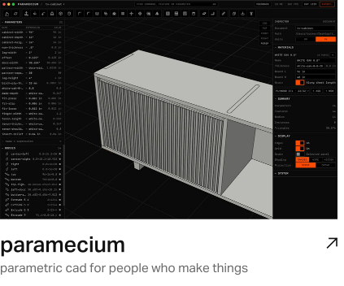
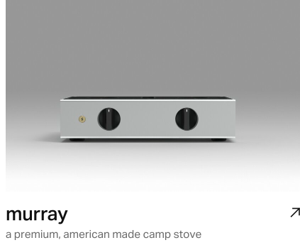
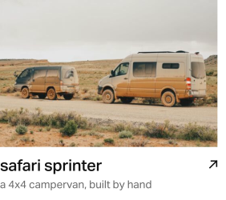
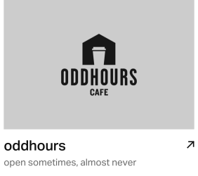
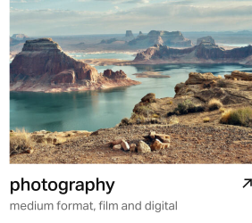

<a href="https://tucker.xxx"><picture><source media="(prefers-color-scheme: dark)" srcset="assets/header-dark.svg"></picture></a>

I direct product design at [Topaz Labs](https://tucker.xxx/portfolio/topaz), where we make AI image and video software. Before that I led the UX design of the Steam Deck™ at [Valve](https://tucker.xxx/portfolio/valve), built the aerospace design system at [Blue Origin](https://tucker.xxx/portfolio/blue-origin), shipped the [Tangerine](https://tucker.xxx/portfolio/tangerine) banking app used by millions of Canadians, and went from intern to design director at [Artefact](https://tucker.xxx/portfolio/artefact). Fifteen-plus years of taking products from zero to one, now from Dallas, TX.

I solve problems with design, code, and AI. Most of what lives here is what I build after hours.

<h2><picture><source media="(prefers-color-scheme: dark)" srcset="assets/label-building-now-dark.svg"></picture></h2>

<a href="https://paramecium.app"><picture><source media="(prefers-color-scheme: dark)" srcset="assets/paramecium-dark.svg"></picture></a><a href="https://www.murray.camp/"><picture><source media="(prefers-color-scheme: dark)" srcset="assets/murray-dark.svg"></picture></a>

**[Paramecium](https://paramecium.app)** is the CAD app I design and build. It is made for 3D printing, sheet metal and woodworking, built on parameters from the ground up, with real-time rendering built in. Swift and OpenCASCADE under a Svelte UI, native on Mac and Windows, in private beta.

**[Murray](https://www.murray.camp/)** is a camp stove I am prototyping and manufacturing. Laser cut and bent aluminum, one burner so far, two on the way.

<h2><picture><source media="(prefers-color-scheme: dark)" srcset="assets/label-away-from-the-keyboard-dark.svg"></picture></h2>

<a href="https://tucker.xxx/campervan/intro"><picture><source media="(prefers-color-scheme: dark)" srcset="assets/van-dark.svg"></picture></a><a href="https://oddhours.cafe"><picture><source media="(prefers-color-scheme: dark)" srcset="assets/oddhours-dark.svg"></picture></a><a href="https://tucker.xxx/photography"><picture><source media="(prefers-color-scheme: dark)" srcset="assets/photography-dark.svg"></picture></a>

- **[Safari Sprinter](https://tucker.xxx/campervan/intro)**, a 2018 Sprinter 4x4 cargo van I turned into our family campervan. Custom everything, from the plumbing to the 24v LiFePO4 battery system to the baltic birch cabinetry.
- **[Oddhours](https://oddhours.cafe)**, a coffee shop run from my kitchen.
- **[Photography](https://tucker.xxx/photography)**, mostly medium format on film and digital.

<h2><picture><source media="(prefers-color-scheme: dark)" srcset="assets/label-working-with-dark.svg"></picture></h2>

Svelte 5 · SvelteKit · TypeScript · SCSS · Electron · Astro · Swift · Metal · C · Cloudflare Workers · React · Figma

<h2><picture><source media="(prefers-color-scheme: dark)" srcset="assets/label-find-me-dark.svg"></picture></h2>

[tucker.xxx](https://tucker.xxx) · [portfolio](https://tucker.xxx/portfolio) · [resume](https://standardresume.co/r/tuckerspofford) · [linkedin](https://www.linkedin.com/in/iamtucker) · [instagram](https://www.instagram.com/tuckerspofford) · [hello@tucker.xxx](mailto:hello@tucker.xxx)
